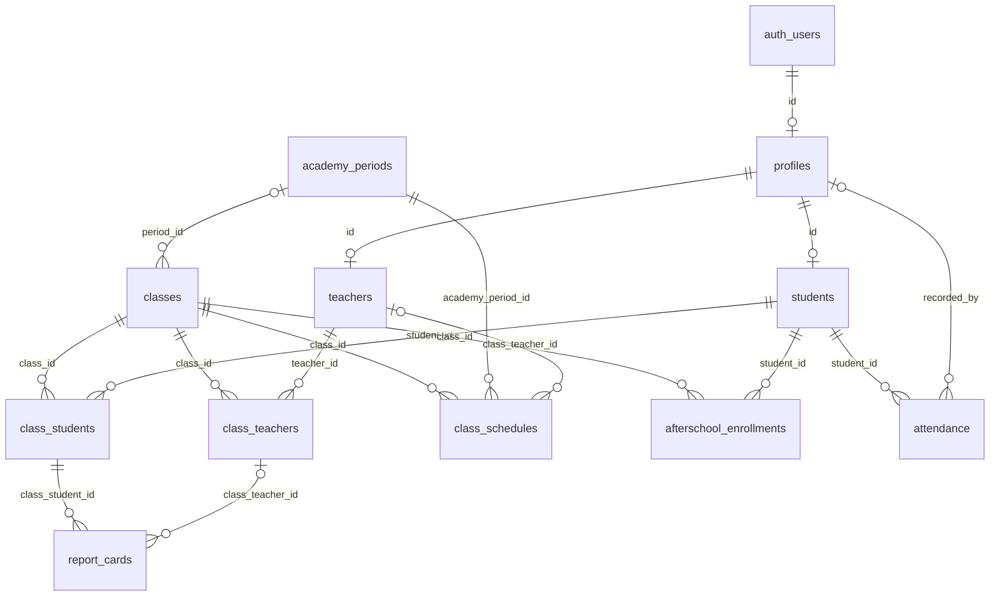
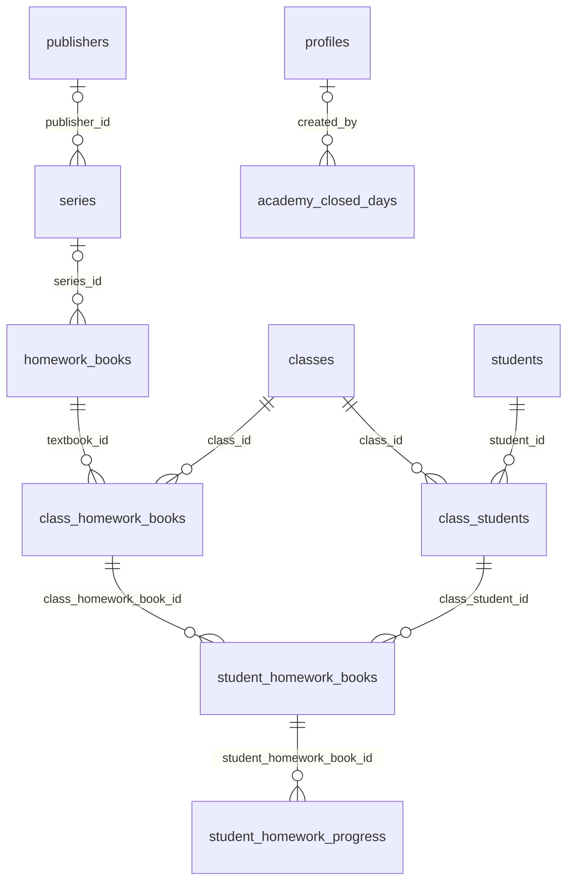
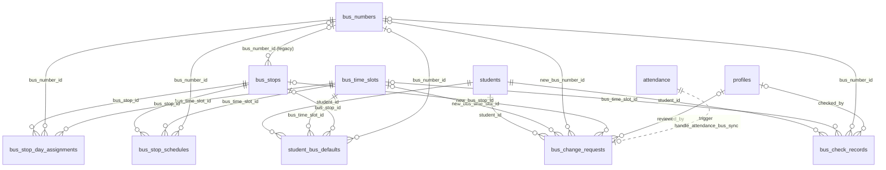
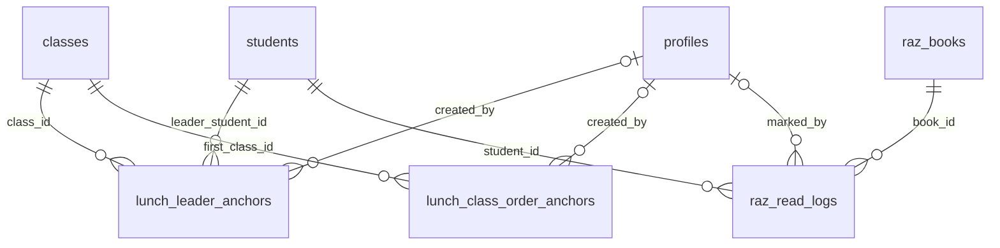

# 데이터 모델

> 기준: `supabase/migrations/` 43개 파일을 전부 적용한 최종 스키마 (마지막 마이그레이션 `20261015130000_drop_default_bus_time_slot.sql`). 작성일 2026-10-28.
> 중간에 drop·rename 된 테이블·컬럼은 최종 상태만 적는다. 코드·DB 는 건드리지 않았다.
> 이미 리뷰된 지적은 반복하지 않고 [`docs/review/REVIEW_DB.md`](review/REVIEW_DB.md) / [`docs/2026-07-12/02-DB리뷰.md`](2026-07-12/02-DB리뷰.md) 로 링크만 건다.
> FK 컨벤션 원문은 [`supabase/AGENTS.md`](../supabase/AGENTS.md).

집계: public 테이블 **33개**, public 간 FK **54개** (profiles → auth.users 포함), enum **8개**.

---

## 1. 도메인별 테이블 목록

### 1.1 사용자·역할 (3)

| 테이블 | 설명 |
|---|---|
| `profiles` | `auth.users` 와 1:1. `role` (admin/teacher/student), `username`, `deleted_at`. 모든 사용자 공통. |
| `students` | 학생. `id = profiles.id` (shared PK). 이름·나이·활성 여부. |
| `teachers` | 교사. `id = profiles.id` (shared PK). `teacher_type` (korean/native). |

admin 은 `profiles` 행만 있고 `students`/`teachers` 행이 없다. 그래서 actor 컬럼은 `profiles(id)` 를 가리킨다.

### 1.2 반·시간표 (6)

| 테이블 | 설명 |
|---|---|
| `classes` | 반. `group_type` (kindergarten/afterschool/afternoon), `days_of_week`, `lunch_group`, 시작 교시 `period_id`. |
| `class_students` | 반–학생 소속 (N:M). 숙제·성적표가 이 행의 `id` 를 참조한다. |
| `class_teachers` | 반–교사 매핑 (N:M). 성적표가 이 행의 `id` 를 참조한다. |
| `academy_periods` | 교시 마스터 (이름·시작/종료 시각·`group_type`). |
| `class_schedules` | 반의 요일별 교시 시간표. 교시 담당 교사 지정 가능. |
| `afterschool_enrollments` | 방과후 요일별 등록. `second_period` 로 1·2차 구분. |

### 1.3 출결 (1)

| 테이블 | 설명 |
|---|---|
| `attendance` | 학생–날짜별 출결 (`attendance_status` enum). 결석이면 트리거가 `bus_change_requests` 에 결석 요청을 자동 upsert. |

### 1.4 숙제 (7)

| 테이블 | 설명 |
|---|---|
| `publishers` | 출판사 마스터. |
| `series` | 교재 시리즈. `total_units`, `cover_image_url` 을 시리즈가 소유. |
| `homework_books` | 교재 단권 (옛 `textbooks`). `series_id`, `level`, `category`. |
| `class_homework_books` | 반에 부여한 교재. `homework_days`, `skip_dates`, `start_unit`, `start_date` 로 스케줄 계산. |
| `student_homework_books` | 반 부여 교재의 학생별 인스턴스. `class_students` 를 경유해 학생과 연결. |
| `student_homework_progress` | 학생–교재–unit 단위 진도. PK `(student_homework_book_id, unit_number)`. |
| `academy_closed_days` | 학원 공통 휴원일. 숙제 스케줄 계산 시 skip 처리. |

부여 체인은 트리거로 자동 시드된다: `class_homework_books` INSERT → 그 반 active 학생마다 `student_homework_books` → `series.total_units` 만큼 `student_homework_progress` (`pending`). `class_students` INSERT 도 같은 체인을 탄다.

### 1.5 버스 (8)

| 테이블 | 설명 |
|---|---|
| `bus_time_slots` | 운행 시간대 마스터 (`label`, `time`). |
| `bus_numbers` | 호차 마스터. |
| `bus_stops` | 정류장 마스터. `bus_number_id` 는 레거시 기본 호차 (nullable). |
| `bus_stop_day_assignments` | 정류장 × 요일 × 시간대 × 호차 배정 (순서 `sort_order`). 2026-10 부터 한 정류장을 여러 호차가 공유. |
| `bus_stop_schedules` | 정류장 × 요일 × 시간대 × 호차별 도착 예정 시각. |
| `student_bus_defaults` | 학생의 요일·방향(pickup/dropoff)별 기본 탑승 (시간대·정류장·호차). |
| `bus_change_requests` | 학생–날짜별 버스 변경/결석 요청 (`bus_change_type`, `bus_change_status`). 출결 트리거가 자동 생성하기도 한다. |
| `bus_check_records` | 학생–날짜별 탑승 체크 기록. |

### 1.6 급식 (점심지도) (2)

| 테이블 | 설명 |
|---|---|
| `lunch_leader_anchors` | 특정 날짜부터 특정 반의 리더 학생 anchor. 회전 계산은 코드(`src/lib/lunch/rotation.ts`). |
| `lunch_class_order_anchors` | 특정 날짜부터 `lunch_group` (7세/6세) 별 첫 반 anchor. |

### 1.7 Raz 리딩 (2)

| 테이블 | 설명 |
|---|---|
| `raz_books` | raz-plus 책 카탈로그 (정적, `int` PK, service role 스크립트로 적재). |
| `raz_read_logs` | 학생–책 읽음 기록. 행 존재 = 읽음 (insert/delete 만, update 없음). |

### 1.8 기타 (4)

| 테이블 | 설명 |
|---|---|
| `notices` | 공지. `author_id` → profiles. 발행 여부·고정 여부. |
| `report_cards` | 월별 성적표. `class_students` 행과 `class_teachers` 행을 참조. |
| `weekly_sentences` | 주차·레벨별 주간 문장. |
| `weekly_sentence_config` | 주간 문장 주차 계산 설정 (singleton 의도, `id integer` PK). |

### 1.9 enum

| enum | 값 |
|---|---|
| `user_role` | admin, teacher, student |
| `teacher_type` | korean, native |
| `class_group` | kindergarten, afterschool, afternoon |
| `attendance_status` | present, absent, late, early_leave, excused |
| `bus_direction` | pickup, dropoff |
| `bus_change_type` | absent, change, no_ride, temporary_change |
| `bus_change_status` | pending, approved, rejected |
| `weekly_sentence_mode` | auto, manual |

enum 이 아닌 text + CHECK: `student_homework_progress.status` (pending/completed/missed), `classes.lunch_group` · `lunch_class_order_anchors.lunch_group` (7세/6세), `homework_books.category` (CHECK 없음, default `main`).

---

## 2. 관계도

표기: `||--o{` 는 NOT NULL FK (부모 1 : 자식 0..N), `|o--o{` 는 nullable FK, `||--o|` 는 shared PK 1:1. 라벨은 FK 컬럼명.

### 2.1 전체

```mermaid
erDiagram
  auth_users ||--o| profiles : "id"
  profiles ||--o| students : "id"
  profiles ||--o| teachers : "id"

  academy_periods |o--o{ classes : "period_id"
  classes ||--o{ class_students : "class_id"
  students ||--o{ class_students : "student_id"
  classes ||--o{ class_teachers : "class_id"
  teachers ||--o{ class_teachers : "teacher_id"
  classes ||--o{ class_schedules : "class_id"
  academy_periods ||--o{ class_schedules : "academy_period_id"
  teachers |o--o{ class_schedules : "class_teacher_id"
  classes ||--o{ afterschool_enrollments : "class_id"
  students ||--o{ afterschool_enrollments : "student_id"

  students ||--o{ attendance : "student_id"
  profiles |o--o{ attendance : "recorded_by"

  publishers |o--o{ series : "publisher_id"
  series |o--o{ homework_books : "series_id"
  classes ||--o{ class_homework_books : "class_id"
  homework_books ||--o{ class_homework_books : "textbook_id"
  class_students ||--o{ student_homework_books : "class_student_id"
  class_homework_books ||--o{ student_homework_books : "class_homework_book_id"
  student_homework_books ||--o{ student_homework_progress : "student_homework_book_id"
  profiles |o--o{ academy_closed_days : "created_by"

  bus_numbers |o--o{ bus_stops : "bus_number_id"
  bus_stops ||--o{ bus_stop_day_assignments : "bus_stop_id"
  bus_numbers ||--o{ bus_stop_day_assignments : "bus_number_id"
  bus_time_slots ||--o{ bus_stop_day_assignments : "bus_time_slot_id"
  bus_stops ||--o{ bus_stop_schedules : "bus_stop_id"
  bus_time_slots ||--o{ bus_stop_schedules : "bus_time_slot_id"
  bus_numbers |o--o{ bus_stop_schedules : "bus_number_id"
  students ||--o{ student_bus_defaults : "student_id"
  bus_time_slots ||--o{ student_bus_defaults : "bus_time_slot_id"
  bus_stops |o--o{ student_bus_defaults : "bus_stop_id"
  bus_numbers |o--o{ student_bus_defaults : "bus_number_id"
  students ||--o{ bus_change_requests : "student_id"
  bus_time_slots |o--o{ bus_change_requests : "new_bus_time_slot_id"
  bus_numbers |o--o{ bus_change_requests : "new_bus_number_id"
  bus_stops |o--o{ bus_change_requests : "new_bus_stop_id"
  profiles |o--o{ bus_change_requests : "reviewed_by"
  students ||--o{ bus_check_records : "student_id"
  bus_time_slots |o--o{ bus_check_records : "bus_time_slot_id"
  bus_numbers |o--o{ bus_check_records : "bus_number_id"
  profiles |o--o{ bus_check_records : "checked_by"

  classes ||--o{ lunch_leader_anchors : "class_id"
  students ||--o{ lunch_leader_anchors : "leader_student_id"
  profiles |o--o{ lunch_leader_anchors : "created_by"
  classes ||--o{ lunch_class_order_anchors : "first_class_id"
  profiles |o--o{ lunch_class_order_anchors : "created_by"

  students ||--o{ raz_read_logs : "student_id"
  raz_books ||--o{ raz_read_logs : "book_id"
  profiles |o--o{ raz_read_logs : "marked_by"

  profiles |o--o{ notices : "author_id"
  class_students ||--o{ report_cards : "class_student_id"
  class_teachers |o--o{ report_cards : "class_teacher_id"
```

`weekly_sentences`, `weekly_sentence_config` 는 FK 가 없어 그림에서 제외.

### 2.2 사용자 · 반 · 출결

### 2.3 숙제

학생은 `student_homework_books` 에 직접 연결되지 않고 `class_students` 를 거친다. 그래서 반에서 빠지면 (`class_students` 삭제) 그 반 교재의 진도도 CASCADE 로 함께 사라진다.

### 2.4 버스

마지막 점선은 FK 가 아니라 트리거 연동이다. `attendance.status = 'absent'` 이면 같은 학생·날짜의 `bus_change_requests` 가 `absent/approved` 로 upsert 되고, 결석이 풀리면 자동 생성분만 삭제된다 (주말 제외).

### 2.5 급식 · Raz

---

## 3. 테이블별 핵심 컬럼

관계·규칙에 관련된 컬럼만 적는다. `created_at` / `updated_at` 은 생략. ON DELETE 는 `C` = CASCADE, `N` = SET NULL, `R` = RESTRICT, `-` = NO ACTION.

### 3.1 사용자·역할

| 테이블 | PK | FK | 제약·규칙 |
|---|---|---|---|
| `profiles` | `id` | `id` → `auth.users` (C) | `role user_role` nullable. `username` partial UNIQUE (not null 만). `deleted_at` soft delete. |
| `students` | `id` | `id` → `profiles` (C) | `korean_name` NOT NULL. `is_active`. `group_type text` (enum 아님). |
| `teachers` | `id` | `id` → `profiles` (C) | `teacher_type teacher_type` default korean. `name` nullable. `is_active`. |

### 3.2 반·시간표

| 테이블 | PK | FK | 제약·규칙 |
|---|---|---|---|
| `classes` | `id` | `period_id` → `academy_periods` (N) | `group_type class_group` NOT NULL. `days_of_week int[]` default {1..5}, CHECK 1~5 원소 & ⊆ {1..5}. `lunch_group` CHECK NULL/7세/6세. `is_active`. |
| `class_students` | `id` | `class_id` → `classes` (C), `student_id` → `students` (C) | UNIQUE `(class_id, student_id)` (constraint 2개: baseline 의 `class_students_unique` + 20260520 의 `_key`). `is_active`. |
| `class_teachers` | `id` | `class_id` → `classes` (C), `teacher_id` → `teachers` (C) | UNIQUE `(class_id, teacher_id)`. |
| `academy_periods` | `id` | — | `group_type class_group` NOT NULL. CHECK `start_time < end_time`. `sort_order`. |
| `class_schedules` | `id` | `class_id` → `classes` (C), `academy_period_id` → `academy_periods` (R), `class_teacher_id` → `teachers` (N) | UNIQUE `(class_id, academy_period_id, day_of_week)`. `day_of_week` CHECK 1~5. `label text`. |
| `afterschool_enrollments` | `id` | `class_id` → `classes` (C), `student_id` → `students` (C) | UNIQUE `(class_id, student_id, day_of_week)`. `day_of_week` CHECK 1~5. `second_period boolean` default false. |

### 3.3 출결

| 테이블 | PK | FK | 제약·규칙 |
|---|---|---|---|
| `attendance` | `id` | `student_id` → `students` (C), `recorded_by` → `profiles` (N) | UNIQUE `(student_id, attendance_date)`. `status attendance_status`. 트리거 `after_attendance_bus_sync` (INSERT / UPDATE OF status). |

### 3.4 숙제

| 테이블 | PK | FK | 제약·규칙 |
|---|---|---|---|
| `publishers` | `id` | — | partial UNIQUE `lower(name)` where `is_active`. |
| `series` | `id` | `publisher_id` → `publishers` (N) | partial UNIQUE `lower(name)` where `is_active`. `total_units int` NOT NULL default 0 (0 이면 진도 시드 skip). `cover_image_url`. |
| `homework_books` | `id` | `series_id` → `series` (N) | `title` NOT NULL. `level`, `category` (default main), `sort_order`, `is_active`. 레거시 `publisher text` 잔존 (§4 참고). |
| `class_homework_books` | `id` | `class_id` → `classes` (C), `textbook_id` → `homework_books` (C) | UNIQUE `(class_id, textbook_id)`. `homework_days int[]` ⊆ {0..6} (0=일). `skip_dates date[]`. `start_unit int` ≥ 1 default 1. `start_date date` nullable. `note`. |
| `student_homework_books` | `id` | `class_student_id` → `class_students` (C), `class_homework_book_id` → `class_homework_books` (C) | UNIQUE `(class_student_id, class_homework_book_id)`. `start_date date` 잔존 (§4 참고). |
| `student_homework_progress` | `(student_homework_book_id, unit_number)` | `student_homework_book_id` → `student_homework_books` (C) | `unit_number` CHECK ≥ 1. `status text` CHECK pending/completed/missed, default pending. surrogate id 없음. |
| `academy_closed_days` | `id` | `created_by` → `profiles` (N) | `closed_date date` UNIQUE. `label`. |

시드 트리거 (모두 SECURITY DEFINER): `tg_class_homework_book_seed_students` (class_homework_books INSERT), `tg_class_student_seed_homework_books` (class_students INSERT), `tg_student_homework_book_seed_progress` (student_homework_books INSERT, `series.total_units` 기준).

### 3.5 버스

| 테이블 | PK | FK | 제약·규칙 |
|---|---|---|---|
| `bus_time_slots` | `id` | — | `label`, `time text` (예: `16:20`). `show_empty_stops`. `is_active`. |
| `bus_numbers` | `id` | — | `label`. `is_active`. |
| `bus_stops` | `id` | `bus_number_id` → `bus_numbers` (N) | `name`, `sort_order`, `is_active`. `bus_number_id` 는 다중 호차 공유 이후 레거시. |
| `bus_stop_day_assignments` | `id` | `bus_stop_id` → `bus_stops` (C), `bus_number_id` → `bus_numbers` (C), `bus_time_slot_id` → `bus_time_slots` (C) | UNIQUE idx `(bus_stop_id, day_of_week, bus_time_slot_id, bus_number_id)` NULLS NOT DISTINCT. `bus_time_slot_id` NOT NULL (2026-10). `sort_order`. |
| `bus_stop_schedules` | `id` | `bus_stop_id` → `bus_stops` (C), `bus_time_slot_id` → `bus_time_slots` (C), `bus_number_id` → `bus_numbers` (C) | UNIQUE idx `(bus_stop_id, day_of_week, bus_time_slot_id, bus_number_id)` NULLS NOT DISTINCT. `bus_time_slot_id` NOT NULL. `estimated_time text`. |
| `student_bus_defaults` | `(student_id, direction, day_of_week)` | `student_id` → `students` (C), `bus_time_slot_id` → `bus_time_slots` (C), `bus_stop_id` → `bus_stops` (N), `bus_number_id` → `bus_numbers` (N) | `direction bus_direction`. UNIQUE `(student_id, day_of_week)` 가 다시 존재 (§4 참고). |
| `bus_change_requests` | `id` | `student_id` → `students` (C), `new_bus_time_slot_id` → `bus_time_slots` (N), `new_bus_number_id` → `bus_numbers` (N), `new_bus_stop_id` → `bus_stops` (N), `reviewed_by` → `profiles` (N) | UNIQUE `(student_id, request_date)`. `change_type bus_change_type`, `status bus_change_status` default pending. |
| `bus_check_records` | `id` | `student_id` → `students` (C), `bus_time_slot_id` → `bus_time_slots` (N), `bus_number_id` → `bus_numbers` (N), `checked_by` → `profiles` (N) | UNIQUE `(student_id, check_date)`. |

### 3.6 급식

| 테이블 | PK | FK | 제약·규칙 |
|---|---|---|---|
| `lunch_leader_anchors` | `id` | `class_id` → `classes` (C), `leader_student_id` → `students` (C), `created_by` → `profiles` (N) | UNIQUE `(effective_from, class_id)`. |
| `lunch_class_order_anchors` | `id` | `first_class_id` → `classes` (C), `created_by` → `profiles` (N) | UNIQUE `(effective_from, lunch_group)`. `lunch_group` CHECK 7세/6세. |

### 3.7 Raz

| 테이블 | PK | FK | 제약·규칙 |
|---|---|---|---|
| `raz_books` | `id int` | — | `level` (aa~Z2), `level_order int`, `lexile_num int`, `multilevel`. 쓰기 정책 없음 (service role 적재). |
| `raz_read_logs` | `(student_id, book_id)` | `student_id` → `students` (C), `book_id` → `raz_books` (-), `marked_by` → `profiles` (-) | INSERT 시 `marked_by = auth.uid()` 를 RLS 로 강제. UPDATE 정책 없음. |

### 3.8 기타

| 테이블 | PK | FK | 제약·규칙 |
|---|---|---|---|
| `notices` | `id` | `author_id` → `profiles` (N) | `is_published`, `is_pinned`, `published_at`. anon SELECT 는 published 만. |
| `report_cards` | `id` | `class_student_id` → `class_students` (C), `class_teacher_id` → `class_teachers` (N) | UNIQUE `(class_student_id, year, month)`. `content_en/ko`, `reply_en/ko`. |
| `weekly_sentences` | `id` | — | UNIQUE `(week_number, level)`. |
| `weekly_sentence_config` | `id integer` | — | `mode weekly_sentence_mode`. sequence 없음 (singleton 의도). |

---

## 4. 확인 필요

고치지 않고 나열만 한다. 이미 리뷰 문서에 있는 항목은 링크만.

### 4.1 FK 컨벤션 vs 실제 스키마

컨벤션 위반 (학생 컬럼이 `profiles` 를 가리키는 등) 은 최종 스키마에 **없다**. 다만 이름·참조가 어긋나거나 정책이 들쭉날쭉한 곳:

| # | 위치 | 내용 | 기존 리뷰 |
|---|---|---|---|
| 1 | `class_schedules.class_teacher_id` → `teachers(id)` | 이름은 `class_teacher` 인데 `class_teachers(id)` 가 아니라 `teachers(id)` 참조. `report_cards.class_teacher_id` 는 `class_teachers(id)`. | [REVIEW_DB §7.1, #8](review/REVIEW_DB.md) |
| 2 | `class_homework_books.textbook_id` → `homework_books(id)` | `textbooks` 테이블 rename 후 컬럼명만 남음. | [REVIEW_DB §7.1, #7](review/REVIEW_DB.md) |
| 3 | `raz_read_logs.marked_by` → `profiles(id)` | 다른 actor 컬럼은 전부 ON DELETE SET NULL 인데 여기만 NO ACTION. profiles 삭제 시 읽음 기록이 삭제를 막는다. (`book_id` 도 NO ACTION, 카탈로그라 의도일 수 있음.) | 없음 (2026-08 추가) |
| 4 | `bus_stops.bus_number_id` → `bus_numbers(id)` | `20261015120000` 으로 정류장이 여러 호차를 공유하게 되면서 배정은 `bus_stop_day_assignments.bus_number_id` 가 진실. `bus_stops.bus_number_id` 는 남아 있지만 의미가 "기본 호차" 인지 "미사용" 인지 코멘트 없음. | 없음 (2026-10 변경) |

### 4.2 레거시·죽은 컬럼

| # | 위치 | 내용 | 기존 리뷰 |
|---|---|---|---|
| 5 | `homework_books.publisher text` | `20260507020000` 에서 "1 릴리스 후 DROP 예정" 이라 했으나 아직 남음. 출판사는 `series.publisher_id` 로 옮겨짐. | 없음 |
| 6 | `student_homework_books.start_date` | `20260508010000` 에서 추가, 이후 `homework_days/skip_dates/start_unit` 은 드롭됐는데 `start_date` 만 남음. 트리거·마이그레이션 어디서도 안 씀. | [REVIEW_DB #18](review/REVIEW_DB.md) 은 `class_homework_books.start_date` 만 언급 |
| 7 | `class_students` UNIQUE 2개 | `class_students_unique` (baseline) 와 `class_students_class_id_student_id_key` (20260520) 가 같은 `(class_id, student_id)`. | [02-DB리뷰 중복 인덱스](2026-07-12/02-DB리뷰.md) 에 포함 |

### 4.3 `20260615110558_remote_schema.sql` (db pull) 로 되돌아간 것

02-DB리뷰가 셀프승인 가드·anon grant·storage 정책 원복은 이미 다뤘다. 그 외에 같은 파일이 되돌린 것:

| # | 위치 | 내용 |
|---|---|---|
| 8 | `student_bus_defaults` UNIQUE `(student_id, day_of_week)` | `20260601030000` 이 PK `(student_id, direction, day_of_week)` 와 모순이라 드롭했는데 `remote_schema.sql:139-141` 이 다시 추가. 최종 스키마에는 **존재**한다. 같은 요일 pickup + dropoff 두 행을 넣으면 UNIQUE 위반. |
| 9 | `handle_attendance_bus_sync()` | `20260521010000` 이 `reason = coalesce(nullif(reason,''), sentinel)` 로 admin 메모를 보존하게 고쳤는데 `remote_schema.sql:158-213` 본문은 다시 `reason = sentinel` 로 덮어쓴다. |

### 4.4 살아 있는 고아 트리거

| # | 위치 | 내용 |
|---|---|---|
| 10 | `class_students` 의 트리거 `tg_class_student_reactivate_seed` → `tg_class_student_reactivate_seed_units()` | `20260509010000` 에서 만들고 한 번도 drop 하지 않음. 함수 본문이 `homework_unit_progress`, `class_textbooks`, `textbooks` 를 참조하는데 셋 다 이미 drop/rename 됨 (`remote_schema.sql:230-248` 에서 클라우드에도 그대로 있음을 확인). `class_students.is_active` 를 false → true 로 UPDATE 하면 "relation does not exist" 로 실패할 것으로 보임. 실제 재현은 안 했다. |

### 4.5 히스토리 공백

| # | 내용 |
|---|---|
| 11 | `20260518000000` 머리말이 "20260517 array 마이그레이션 (`unit_statuses smallint[]`) 적용 후" 를 출발점으로 삼는데 리포에 `20260517*` 파일이 없다. `drop column if exists unit_statuses` 로 가드돼 있어 적용은 되지만, 클라우드 `schema_migrations` 에 해당 버전이 있는지 확인 필요. |
| 12 | 테이블 수: 이 문서 집계는 33개 (02-DB리뷰 시점 31개 + raz 2개). 과제에 적힌 35개와 다르다. storage 버킷(`textbook-covers`, `raz-covers`, `notice-files`, `class-notices`, `academy-notices`, `homework-submissions`) 은 테이블로 세지 않았다. |

요일 인덱싱 혼재 (`days_of_week`/`day_of_week` 는 1=월~5=금, `homework_days` 는 0=일~6=토) 는 [REVIEW_DB §7.2](review/REVIEW_DB.md) 참고.

---

## 5. 마이그레이션 히스토리 요약

| 시기 | 파일 수 | 내용 |
|---|---|---|
| baseline | 1 | 운영 스키마 스냅샷 22개 테이블: 사용자·반·시간표·출결·버스·공지·성적표·주간문장. |
| 2026-05-07 ~ 05-09 | 8 | 숙제 도메인 도입 (`textbooks`, 반/학생 부여, progress, `series`, `publishers`). 일별 체크(`homework_completion`) 는 이틀 만에 unit grid(`homework_unit_progress`) 로 교체. |
| 2026-05-12 ~ 05-14 | 3 | FK 컨벤션 정비 (학생 컬럼 → `students(id)`), 숙제 actor 컬럼 제거, `report_cards.author_id` → `teacher_id`. |
| 2026-05-15 ~ 05-21 | 7 | 숙제 재구조: `textbooks` → `homework_books`, `class/student_textbooks` → `*_homework_books`, progress 를 `(book, unit)` 복합 PK 로, 학생 연결을 `class_students` 경유로. 출결→버스 트리거 reason 보존. |
| 2026-05-22 ~ 05-24 | 3 | `homework_days` 를 반 → 부여 단위로 이동, `skip_dates` 부활. |
| 2026-05-25 ~ 05-30 | 7 | `classes`/`academy_periods`/`class_schedules`/`report_cards` 리팩토링 (`class_student_id`, `class_teacher_id`, `days_of_week`, `period_id`), `series` 가 `total_units`/표지 소유, 점심지도 anchor 2개 테이블. |
| 2026-06-01 ~ 06-03 | 8 | 보안 패치 (셀프승인 가드, anon revoke, 반 SELECT 좁히기 + 재귀 수정, storage 버킷 4개 정책), `academy_closed_days`, 방과후 `second_period`. |
| 2026-06-15 | 1 | `remote_schema.sql` (db pull). 직전 보안 패치 일부 원복 → [02-DB리뷰](2026-07-12/02-DB리뷰.md), §4.3. |
| 2026-08-15 | 1 | Raz 리딩 (`raz_books`, `raz_read_logs`, `raz-covers` 버킷). |
| 2026-10-15 | 2 | 버스 정류장 다중 호차 공유 (`bus_stop_day_assignments`/`bus_stop_schedules`/`student_bus_defaults` 에 호차), 기본 시간대(NULL) 제거. |
